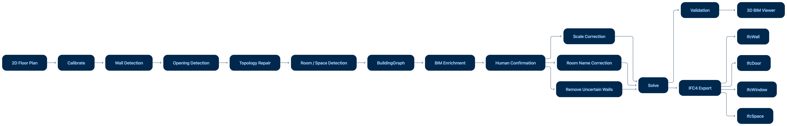

## 2D Floor Plan → BIM/IFC4 Pipeline

The application converts a 2D floor-plan image into a structured BIM representation and finally exports it as an open IFC4 model.

1. **Input** – The user uploads a floor-plan image or PDF.
2. **Calibration** – The image is calibrated to establish the relationship between pixels and real-world meters.
3. **Wall Detection** – Walls are detected and converted into geometric wall elements with position, length, direction, and thickness.
4. **Opening Detection** – Doors and windows are detected and associated with their host walls.
5. **Topology Repair** – Wall connections and opening relationships are repaired to produce a consistent building topology.
6. **Space Detection** – Enclosed regions are identified as rooms/spaces and their areas are calculated.
7. **BuildingGraph** – Walls, openings, spaces, scale, and other geometry are stored in a structured intermediate BIM representation.
8. **BIM Enrichment** – BIM/IFC metadata is added to the detected elements.
9. **Human Confirmation** – The user can correct scale, rename rooms, and remove uncertain walls before final generation.
10. **Solve & Validate** – The graph is finalized, validated, and checked for topology and data consistency.
11. **3D BIM** – The validated graph is converted into a 3D representation for visualization.
12. **IFC4 Export** – The final model is exported as real IFC entities such as `IfcWall`, `IfcDoor`, `IfcWindow`, and `IfcSpace`.

### Key Design Principle

The pipeline uses **computer vision, geometry processing, topology, and deterministic BIM rules** to construct the model. The LLM is not responsible for generating the geometry.

